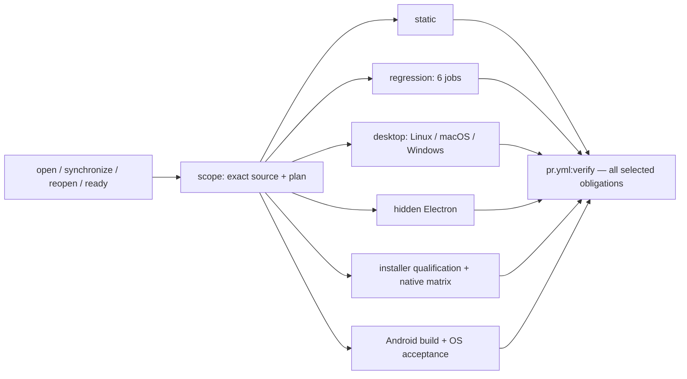

# PR critical path pilot

На исходной конфигурации цель 10× **не подтверждена**. В последних 100 repository runs нашлось 12 зелёных PR: p50 **34:06**, p95 **50:30**. Нельзя сравнивать с main p50 1:05: main обычно использует уже заработанное exact-tree PR qualification. Представительный PR тратит 33:25 на Android из общих 34:46; это обязательная работа до merge. Удаление ВСЕГО scope+verify сократило бы его максимум в **1.026×**.

Реализован меньший безопасный пилот: тот же aggregate validator и follow-up policy выделены в модули без установленных пакетов; `pr.yml:verify` использует Node без установки зависимостей приложения. Никакая выбранная проверка, платформа или provenance не исключена. [Draft PR #25](https://github.com/KOSFin/opka/pull/25), исходный исполняемый candidate `6f4a8d2cacd12439e60077637b76c836bde5cc6a`, база `7d7a8ffa83fdff34df5211a294f6b076bbee44b4`, [эксперимент 45075379341, attempt 1](https://github.com/KOSFin/opka/actions/runs/45075379341). Full qualification завершился **success**:34:41 до aggregate, сам verify15s. Все6lanes пройдены; qualification head/tree/run/attempt/event проверены. Draft-skipped PR context и manual dispatch не являются pull_request qualification для merge. Перед возможным merge понадобится новый non-draft pull_request run на тогдашнем exact head/tested merge; этот пилот PR оставляет draft и ничего не merge.

## Измерения, входы и ограничения

[История и красный/зелёный timeline](actions-evidence.md) содержат исходные SHA, разницу source head и synthetic merge SHA, критические ветви, caches и методику. [Матрица событий](actions-events.md) охватывает open, feature push, synchronize/reopen, re-review, base changes, main merge, tag/release, manual/retry, draft и merge queue, включая дополнительные workflows и дубли.

| Естественная недавняя выборка | n | p50 | p95 |
| --- | ---: | ---: | ---: |
| До зелёного PR aggregate | 12 | 34:06 | 50:30 |
| До первой failed step/job PR | 34 | 4:02 | 38:41 |
| До зелёного main aggregate | 12 | 1:05 | 1:23 |
| До завершённой release publication | 9 | 40:53 | 82:44 |

Всего собраны 79 runs / 86 attempts: 73 из естественной выборки последних 100 runs и 6 специально выбранных старых примеров. Последние не подмешиваются в сопоставимый p50/p95. Все 217 runs индексированы тремя bounded API запросами. Per-attempt job/step timestamps сохранены; DAG восстановлен из исходных YAML ревизий, 36 уникальных YAML, missing 0. Original webhook payload и большинство исторических synthetic merge объектов недоступны: снимок YAML по source head не выдается за доказательство полного tested merge tree.

Elapsed считается от API run.created_at: точный push receipt неизвестен. Первая failed step completion — доступная верхняя оценка первого actionable failure, а не момент первой строки error в stdout. PR review approvals, обязательные внешние статусы и человеческие решения не входят в CI-ready метрику. Nearest-rank p95 при n12 — почти максимум; причинной оценки всего CI по этой выборке нет.

Runner work суммируется по реально исполненным job intervals; elapsed — конечная точка критической ветви, без суммы параллельных стадий. Jobs, перенесённые API в retry с новыми ID и старыми timestamps, дедуплицированы. В естественной выборке: 46 PR runs / 50 attempts — **5350.83 runner-min**, 14 main — **20.47**, 11 release / 14 attempts — **941.93**. Это занятость runners, без тарифов, OS-множителей и платёжных округлений. Сумма очередей jobs описывает спрос, её нельзя прибавлять к elapsed. Initial queue для первой попытки PR n45 с фактическим runner start (ещё1run отменён до исполнения): p50 3s / p95 23s; retry waiting отдельно, точный rerun-request timestamp неизвестен.

Красный [43242425126](https://github.com/KOSFin/opka/actions/runs/43242425126): первая ошибка changed-code 2:53, regression 4:41, Electron 13:31, Android 31:38, aggregate red 32:08. Зелёный [43628616296](https://github.com/KOSFin/opka/actions/runs/43628616296): runner 0:23, scope 0:51, Electron 9:02, installers 27:49, Android 34:19, aggregate 34:46. Для быстрой обратной связи полезен первый actionable error, а не ожидание финального red aggregate.

Для обычного PR после scope все выбранные ветви идут параллельно; verify ждёт самую длинную. Это зависимости текущей конфигурации, а не сумма длительностей:



Невыбранные ветви должны быть именно skipped, выбранные — success; unexplained skipped/failure/cancelled не дают qualification. Main reuse и release имеют отдельные trust/needs ветви, описанные в history/DAG данных; они не используются для сравнения холодного PR времени.

## Качество решений по типам изменений

| Вход | Что остаётся обязательным сейчас | Оценка |
| --- | --- | --- |
| Docs | static и затем verify; types/mobile install сокращены существующей политикой | Удаление aggregate install даёт наибольший относительный эффект на коротком пути; docs-only контролируемого A/B нет. |
| Карточка renderer | static, regression, desktop Linux/macOS/Windows, hidden Electron | n=0 изолированных card PR. Существующая политика уже исключает installers/Android; глобальная shared regression/physical scope может доминировать. Не обещать 34→3 минуты по all-lane примеру. |
| cloud/server-only | cloud выбирает static+regression; src/main выбирает все lanes | Это разные execution/runtime contracts. n=0 изолированных server PR. Исключать Android по одному имени каталога небезопасно. |
| Shared/runtime | Все lanes | Изменения доходят до desktop, remote host и mobile. Нужен доказанный indirect-input closure прежде дальнейшего narrowing. |
| Lockfile/build/unknown | Full qualification | Package policy, generated outputs, toolchain и неизвестные пути инвалидируют узкий план. Пилот это не меняет. |
| CI | Workflow/build-policy пути full; существующие точные CI-test/admission исключения сохранены | Сам workflow-пилот проверяется полным manual run и дополнительно паритетом старого/нового gate. |
| Android | static+regression+Android для mobile runtime; shared/build inputs могут включить всё | Native unit tests, APK compilation и OS retention обязательны. Download cache не равен tested-result cache. |

## Фактический before/after эксперимент

Диагностика включена только явным `workflow_dispatch aggregate_probe=true`, **вместе** с полным qualification. Production PR/main jobs диагностикой не заменяются. Нет publish/merge/изменений protections. Перед запуском проверено отсутствие эквивалентных active runs; feature push этого workflow не запускает. Draft PR создал отдельный skipped-only run, не второй полный прогон.

Baseline pinned на `7d7a8ffa`, manifests package/lock/workspace сравниваются до install. Каждый из трёх hosted runners сначала реально исполняет candidate при asserted отсутствии node_modules (2758 cases), затем после script-free dependency install сравнивает baseline и candidate на **2760 одинаковых cases**, включая точные red/green env из исторических verify logs. Дополнительно сравниваются 10 routing inputs: docs, card, cloud, src/main, shared, lockfile, CI, Android, unknown и mixed indirect input. Фактическая экономия setup по одинаковому toolchain/manifest на одном runner измерена отдельно: baseline dependency-install composite занял9s Linux,29s macOS,24s Windows; cold candidate entry0s/0s/1s в секундном REST разрешении. Предшествующий setup-node2–5s общий, checkout и artifact overhead не исключены из реального job. Baseline install выполняется после первичного setup-node, поэтому это измерение удаляемого composite, а не независимый cold whole-job A/B.

Отдельный [draft diff-quality run45076783719](https://github.com/KOSFin/opka/actions/runs/45076783719) проверил реальные changed lines относительно approved base и прошёл. Это необходимая дополнительная проверка: manual full fallback задаёт scope.base=head, поэтому его changed-code success сам по себе не доказывал lint новых строк. Для адресного run временно добавлен draft-only one-shot job, затем удалён; regular draft admission в итоговом YAML восстановлен. Код приложения/aggregate при этом не менялся.

Linux запускает пять существующих regression files: **171 tests passed**, 2.79s. Все три diagnostic jobs прошли.

Гарантия эксперимента — одинаковое принятие/отказ для выбранных обязательств и сохранение qualification schema/head/tree/run/attempt/event. Матрица покрывает все 64 комбинации lanes; missing, failure, cancelled, skipped, timed_out, exact-tree reuse и валидный/подделанный follow-up. Существующие targeted tests проверяют fork/refusal и недоказанный reuse; новый код не расширяет trust/path allowlists. Исторические красные тесты сами заново не исполнялись: replay проверяет отказ aggregate на их сохранённых фактических результатах. Это ровно затронутая пилотом гарантия.

Время evaluator-loop после imports — Linux 7.27ms candidate / 4.46ms baseline, macOS 6.44 / 4.22, Windows 12.11 / 9.77, каждый n1. **Это не ускорение evaluator** и не время CI: выигрывает отсутствие setup/install/internal-package-build. На cold candidate loop 7.07/12.65/11.80ms Linux/macOS/Windows; startup и setup измеряются job/step timestamps отдельно. Эти миллисекунды не используются для обещания ×скорости.

Cold здесь означает нет dependency installation/node_modules; второй проход после install, с теми же obligations. Candidate не зависит от dependency cache в обоих случаях. В diagnostic переданы `cache-pnpm-store=false` и `cache-pnpm-verification=false`; это настройки нашего composite, не доказательство отсутствия любого внутреннего кэша вложенного pnpm/setup. Полного контролируемого cold/warm A/B всей Android/installers цепочки нет; исторические warm/miss receipts не подменяют такой эксперимент. Новый run не называется сопоставимым общим PR latency A/B: manual выбирает полный план, application/dependency inputs совпадают, но cache, runners и changed-test selection не контролировались. Baseline7d7a8ffa имеет ровно tree58981fcbc3250ddb2608bf9ac03e93cb71c37d1c из исторического green proof43628616296; candidate меняет только CI/scripts/docs, без src/mobile/cloud/native/resources/manifests. Receipt — `pilot-comparable-inputs.json`. Это улучшает сопоставимость, но не превращает весь run в контролируемый A/B. В новом Linux setup измерен Node24.22.3; исторический native-cache receipt использовал24.22.2. Same-run diagnostic использует один24.22.3 для обоих вариантов, но historical whole-run toolchain не идентичен; excerpts сохранены.

### Итог реального run

Полный `.github/workflows/pr.yml` run45075379341/attempt1 **success**, source6f4a8d2cac.37jobs:33исполнены,4планово skipped; все6selected lanes прошли. Production verify job137381531994success за15s. Proof: head6f4a8d2cacd12439e60077637b76c836bde5cc6a, tree3ffc6c07a56d3d30f47062130fad008abd9f0a6e, run45075379341, attempt1, eventworkflow_dispatch. Saved JSON — `pilot-qualification/qualification.json`, metadata/steps/artifacts — `pilot-run.json(.gz)`, `pilot-jobs.json.gz`, `pilot-artifacts.json.gz`, итог — `pilot-summary.json`.

| Наблюдение, каждый n1 | Исторический PR43628616296 | Candidate manual45075379341 |
| --- | ---: | ---: |
| Initial scheduling |23s|4s|
| scope |28s|37s|
| Android job |33:25|33:40|
| verify |25s|15s|
| До aggregate |34:46|34:41|
| Runner busy minutes без diagnostic |131.80|138.27|
| Diagnostic overhead |0|3.17|

Общее наблюдаемое elapsed уменьшилось всего на5s (1.0024×), verify на10s. Это **не** причинная оценка полного ускорения: другой event, Node patch, cache state, scheduler и changed-test selection. В same-run diagnostic измерен удаляемый9s Linux dependency composite. Полный новый run израсходовал141.43runner-min с диагностикой; сам selected qualification138.27 против исторических131.80. Таким образом, экономии общих затрат и10× этот эксперимент **не доказал**. First upstream failure у нового green run отсутствует; для red истории replay доказал сохранение отказа, а не более раннее исполнение теста.

Только этот manual source commit имеет исполненный зелёный aggregate. Последующие commit меняют reports/journal; workflow/scripts побайтово совпадают с6f4a8d2cac, подтверждено независимо и `pilot-source-equality.json`. Текущий PR остаётся draft: manual proof с eventworkflow_dispatch не проходит existing PR-only reuse и **не разрешает merge** текущего head. Перед любым будущим merge требуется non-draft PR exact-head/tested-tree qualification.


## Почему setup/cache tuning недостаточно

В исходном Android controller есть и проверяемый source-level предел: `mobile/scripts/compare-android-idle-performance.py` последовательно измеряет два APK × foreground/background по60s и ждёт10s после каждого запуска. Это минимум260s измерительных окон/ожидания, ещё до установки, boot, UI, native updater и build. Это **вывод из конфигурации**, не отдельный измеренный benchmark. Для all-lane примера10× означало бы208.6s на весь CI — меньше одного этого последовательного этапа. Сократить окно60s до6s означало бы изменить качество проверки; пилот этого не делает. Параллелизация независимых устройств/доказанное reuse — другая гипотеза, требующая отдельной проверки сопоставимости измерений.

APK download/build cache может уменьшить611s компиляции в примере, но не выполняет native unit tests или727s emulator acceptance. GitHub cache branch scopes также мешают считать следующий чужой PR «тёплым»: PR-local cache другого PR не становится trusted default-branch cache. Быстрый main с exact-tree proof не обязан заново прогревать все пропущенные build caches. Поэтому cache-hit rate, trust boundary и выбранные обязательства нужно измерять отдельно. Для card-only Android уже не выбран; эти Android пределы не переносятся на card latency, где isolated n=0.

Для первого полезного отказа следующий малый эксперимент — порядок static-проверок. В red43242425126 types66s + mobile types22s предшествовали quality24s. Перенос quality раньше дал бы **прогноз**1:25 вместо2:53 при тех же длительностях, сохраняя все команды на зелёном пути. Но в естественной выборке и quality, и types первыми падали по4раза; другой порядок может задержать type error. Поэтому это trade-off, а не автоматически лучший вариант. Сам этот aggregate-пилот не ускоряет первый upstream failure, он сокращает финальное подтверждение результата. Частоты всех первых failed steps сохранены в summary, включая regressions/physical-scope/Android/artifacts/gate failures; такая ошибка не обязательно означает дефект исходного кода.

## Следующий шаг и CI-v2

Лучший следующий шаг для 10× — отдельный shadow-пилот на **реальных малых PR**: доказать полное множество indirect inputs для independent shared regression/replay/physical-scope и Android fixtures, затем сравнить обязательные результаты старой/новой схемы на одних source/base/toolchain inputs, в том числе исторически красных. Начать со времени самого длинного выбранного predecessor и повторных APK/Gradle результатов, а не нового scheduler. Любое reused native/platform evidence должно иметь producer identity, exact source/input tree, toolchain/ABI/environment, tests и hashes; cache miss/неизвестный вход выполняет прежнюю обязательную работу. Если после сокращения выбранной ветви доминирует Electron/installer, измерить новый путь. Это исследование, не уже доказанное разрешение пропусков.

[Официальные GitHub/Gradle/Nx/Turbo/Vitest источники](official-research.md) и [GitLab MR адаптация](gitlab-portability.md) отделены от GitHub измерений. Gradle incremental/task outputs перспективны для Android; Nx/Turbo дают declared input DAG/result cache, но не знают opaque runtime/installer/CLI гарантий автоматически. Vitest related не видит все computed inputs. Внедрение не делает нынешний 34-minute DAG трёхминутным без доказательств корректности и изменения критической ветви.

| Вариант | Цена эксплуатации | Сложность и переносимость |
| --- | --- | --- |
| Текущий Actions + этот пилот | Небольшая экономия финального job; hosted runners и имеющиеся artifacts/cache | Нет нового сервиса. Валидатор/provider receipts переносятся; repo path policy нет. |
| Gradle/Nx/Turbo поверх текущего CI | Оплата runners + возможный cache backend, hit-rate и invalidation maintenance | Несколько целевых интеграций, правильный graph и shadow coverage важнее бренда. Неизмеренная экономия. |
| Собственный CI-v2 / remote execution | Runner fleet, cache/storage/egress, queue/admission, auth/trust, обновления OS/SDK, monitoring/on-call | Самая высокая стоимость сопровождения. Нужны provider adapters, retry/cancel state machine и надёжный exact-input proof. Сейчас численного business case нет. |

Оценка планирования, не измерение: доработать instrumentation/малый gate — дни; проверенное native/result reuse для этого многоплатформенного дерева — недели итераций; самостоятельный provider-neutral CI service — месяцы и постоянная эксплуатация. Не стоит начинать с него ради недоказанного 10×. Модель будущей цены: сумма `runner_duration × OS_rate` + storage/egress + обслуживание; здесь сохранены runner minutes, денежных тарифов/стоимости чужого проекта не выдумываем.

Для второго проекта переносим схему измерений, fail-closed classifier, verifier obligations и доказательства source/toolchain, но заново определяем paths, native platforms, secrets/fork trust, events и baseline. В GitLab: workflow:rules предотвращает branch+MR duplicate pipelines, needs задаёт DAG; optional/missing jobs должны проверяться итоговым manifest, protected cache boundaries отличаются. Отдельно протестировать merged-results pipelines и merge trains. GitLab runs здесь не измерялись.

## Воспроизведение и файлы

Команды read-only истории приведены в [actions-evidence.md](actions-evidence.md), SHA256/URL источников — в receipts. `actions_dataset.py` читает lossless JSON.gz; compression receipt подтверждает roundtrip. [Независимое ревью](independent-review.md) подтвердило неизменность policy и evaluator; найденный import исправлен до remote experiment.

Итог одного существующего run без dispatch/rerun: `python3 -B fork-docs/reports/ci-critical-path-pilot/pilot-results.py 45075379341` (после завершения сохраняет jobs, artifacts, elapsed/cost и сверяет qualification head/tree/run/attempt/event).

Source-only equivalence, без установки зависимостей: `python3 -B fork-docs/reports/ci-critical-path-pilot/source-parity.py`.

Remote experiment (повторять только при новой необходимости, не дублировать активные runs):

```sh
gh run list --repo KOSFin/opka --workflow pr.yml --branch codex/ci-critical-path-pilot
gh workflow run pr.yml --repo KOSFin/opka --ref codex/ci-critical-path-pilot -f aggregate_probe=true
gh run view 45075379341 --repo KOSFin/opka --json headSha,status,conclusion,jobs
gh run download 45075379341 --repo KOSFin/opka --pattern 'aggregate-diagnostic-*' --dir <owned-directory>
```

Локально запуск тяжёлой проверки первоначально отказал admission из-за <8GiB свободного диска; unit не создан. После сообщения владельца df подтвердил9.0GiB. Уже исполняемые Actions проверки локально не дублировались. Новая локальная проверка должна заново пройти root-owned admission. Parent/реальные gh/python descendants находились в `opka-ci-audit.scope`, MemoryMax2.5GiB/SwapMax0; cgroup receipts сохранены. Установка SDK, services, изменение protections/рабочей Orca/старого хоста/корпоративных проектов/Codex не выполнялись.

Метрика первой ошибки уточнена: берётся самый ранний failed step/job среди **всех attempts одного исходного PR run**, включая затем успешно исправленные retry. Поэтому n34/p50 4:02, а не n31/p50 3:58 по одним последним attempts; per-attempt исходные значения сохранены.

Отмена43095942157 до запуска не считается нулевой очередью: initial scheduling там null, поэтому natural initial-queue n45. Runner-cost p50/p95 в JSON теперь суммируют все attempts каждого run, а не только последний; общие totals не изменились.
